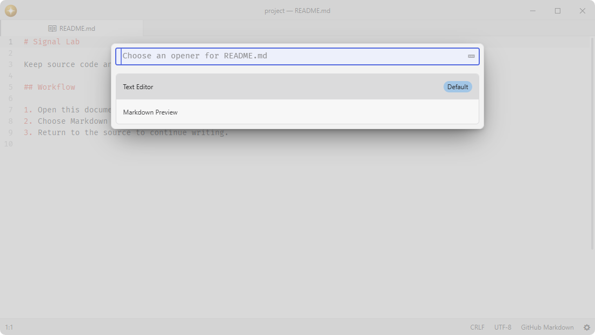
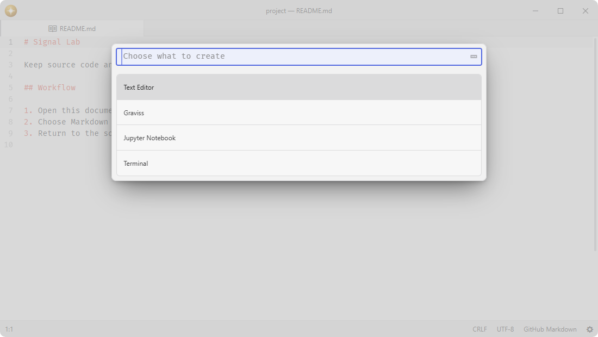

# launcher

Create workspace content and choose how and where to open resources.

## Features

- **New content**: choose a registered content type and create it in the captured editor pane.
- **Resource opening**: choose an available opener, with the default first and the text editor always available for files.
- **Window destinations**: open a document in the current window, a new project window, or a detached editor window.
- **Project and system actions**: open folders as projects, open resources externally, or reveal them in the system file manager.
- **Extensible providers**: packages contribute new content through a disposable service contract.





## Installation

To install `launcher` search for it in the Install pane of the Lumine settings, or run the command `lumine --install lumine-code/launcher`.

## Commands

Commands available in `lumine-workspace`:

- `launcher:new`: choose new content for the current editor pane,
- `launcher:open`: choose a resource and how to open it,
- `launcher:open-resource`: choose how to open the selected tree entry or saved center content.

Commands available in `.launcher .select-list` when opening a resource:

- `launcher:open-current`: use the selected opener in the current window,
- `launcher:open-new-window`: use the selected opener in a new project window,
- `launcher:open-detached-window`: use the selected opener in a detached editor window,
- `launcher:open-this-window`: use the selected opener as the current window's project.

Commands available in `.launcher-new .select-list`:

- `launcher:create`: create the selected content in the captured editor pane.

## Usage

Choose New… from File or a center pane's context menu to select a content type. The chosen provider creates a fresh item; Launcher opens it in that pane's editor area. Each provider owns its document, process, persistence, and save behavior.

Choose Open… from File to select a file and its opener. From the tree or a saved center item, Open… uses that resource directly. The picker marks the action ordinary opening would use as Default. Window destinations apply only to actions that support them. Folders open as projects in a new window by default; This Window switches the current project to the folder.

Packages can request either picker through the launcher service. Capture the initiating pane before asynchronous work. Explicit opening accepts a local path or file URL, zero-based cursor positions, and a URI fragment for viewer destinations. Project requests preserve their complete folder set and launch modes; see the service contract for the request shape.

## Customization

Adjust the picker width and badges in your `styles.css`:

```css
.launcher {
  max-width: 640px;
}
.launcher .badge {
  border-radius: 4px;
}
```

## Services

- [`launcher`](docs/launcher.md): provided to packages that request the Open or New picker.
- [`launcher.provider`](docs/launcher.provider.md): consumed to discover factories for new center content.
- `tree-view.selection`: consumed to read selected paths in the tree.
- `background-tips.provider`: provided to background-tips to explain content creation and resource opening.

## Contributing

Got ideas to make this package better, found a bug, or want to help add new features? Just drop your thoughts on GitHub. Any feedback is welcome!
